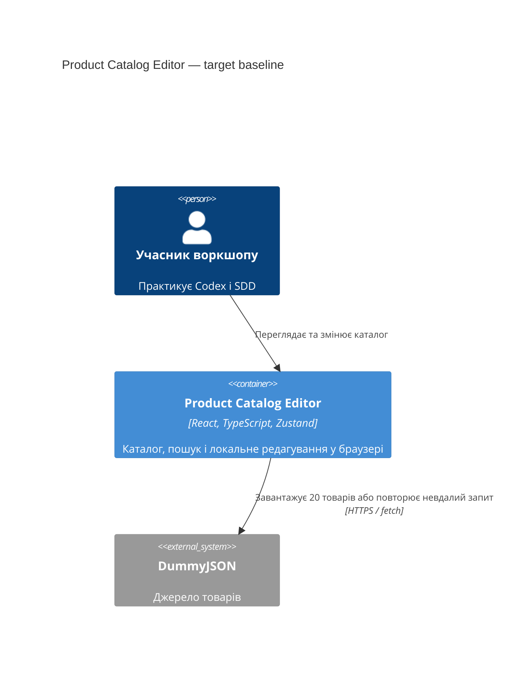

# Architecture map — Product Catalog Editor

Цільова основа нового навчального проєкту, а не опис реалізованого коду. На момент survey у репозиторії є лише документи; package.json, залежності й src ще не створено. Усі шляхи модулів і команди нижче **заплановані**. reflects_commit позначає HEAD до коміту survey. Підстава: [бриф](idea-brief.md), підтверджені автором рішення цього survey. Route: **quick**, depth: **easy**; формальну feature_size ще не класифіковано.

## Stack

- TypeScript зі strict-перевіркою, React, Vite; менеджер пакетів npm. Версії визначимо під час майбутнього scaffold, зараз нічого не встановлюємо.
- Zustand для каталогу та локальних змін; fetch для початкового завантаження й повторної спроби; useState для чернетки форми.
- Звичайний CSS, без бібліотеки компонентів, роутера й серверної частини.
- Заплановані команди: `npm run dev` (Vite), `npm run build` (`tsc -b && vite build`), `npm run test -- --run` (Vitest у разовому режимі), `npm run lint` (ESLint). Вони поки не доступні й не виконувалися.
- Запланована перевірка компонентів: React Testing Library, середовище jsdom. CI поза першою версією.
- Рішення: [ADR-001](adr/001-toolchain.md), [ADR-002](adr/002-catalog-module.md), [ADR-003](adr/003-ephemeral-state.md).

## C4 — target baseline

Діаграма показує користувача, браузерний застосунок і зовнішнє джерело. Zustand і useState — внутрішній стан застосунку, не окремі сервіси.

## Module inventory

Усі наведені нижче шляхи — план; прикладів реалізованого коду поки немає.

| Module | Path | Layers | Wired at | Responsibility |
|---|---|---|---|---|
| App | `src/main.tsx`, `src/App.tsx` | composition | `src/main.tsx` | Монтування React та єдиного екрана каталогу |
| Catalog API | `src/features/catalog/api/products.ts` | external I/O | `model/catalogStore.ts` | GET, перевірка HTTP-відповіді та потрібних полів, перетворення на Product |
| Catalog model | `src/features/catalog/model/` | types, store, selectors | `components/Catalog.tsx` | Product, список, початковий знімок, статус, помилка й дії |
| Catalog UI | `src/features/catalog/components/` | presentation, form | `src/App.tsx` | Catalog, ProductCard, ProductForm, пошук і стани запиту |
| Styles | `src/styles/` | presentation | `src/main.tsx` | Базові стилі, CSS-змінні та класи каталогу |
| Test setup | `src/test/setup.ts` | test infrastructure | `vite.config.ts` | Налаштування Vitest, DOM і очищення після тестів |

## Conventions (cited — the rules a new feature must match)

Посилання ведуть на наявні документи, а не на ще не створений код.

- **Module wiring:** прямі імпорти в одному модулі; UI звертається до store, store — до API; API не імпортує UI або store. Без універсальних шарів і barrel-файлів за замовчуванням — [ADR-002](adr/002-catalog-module.md).
- **Error handling:** статус `idle | loading | success | error` і зрозуміле повідомлення в store; fetch перевіряє `response.ok`, помилки перехоплюються на межі store, UI показує повторну спробу — [ADR-003](adr/003-ephemeral-state.md).
- **IDs:** використовувати числовий id від DummyJSON як ключ і аргумент локальних дій; не генерувати нові id — [ADR-003](adr/003-ephemeral-state.md).
- **Persistence:** лише пам’ять вкладки; оновлювати товари незмінними операціями, початковий знімок не редагувати — [ADR-003](adr/003-ephemeral-state.md).
- **Migrations:** N/A, немає бази даних — [ADR-003](adr/003-ephemeral-state.md).
- **Tests:** Vitest + React Testing Library, файли `*.test.ts` / `*.test.tsx` поруч із модулем; ізоляція store між тестами, fetch підмінюється, тести не залежать від мережі — [ADR-001](adr/001-toolchain.md).
- **UI / styling:** звичайний CSS у `src/styles`, семантичні елементи, label для полів, явний type кнопок; PascalCase для компонентів, camelCase для функцій і змінних — [ADR-002](adr/002-catalog-module.md).
- **CI:** поза першою версією; перевірки запускаються локально — [ADR-001](adr/001-toolchain.md).

## Datastores

| Store | Engine | Accessed via | Notes |
|---|---|---|---|
| Поточні товари й початковий знімок | Zustand у пам’яті | catalogStore | Знімок створюється після успішного завантаження; reset відновлює окремі копії товарів без запиту |
| Чернетка назви й ціни | React useState | ProductForm | Save застосовує зміни до store; Cancel відкидає чернетку |

Серверний запис, localStorage і міграції не потрібні. Мінімальний Product: `id`, `title`, `price`, `thumbnail`. Завантаження нормалізує лише потрібні поля, без збереження всього зовнішнього об’єкта. Повторна спроба стосується невдалого завантаження; звичайні локальні дії не виконують запитів. Джерело: [бриф §1, §5, §7](idea-brief.md), [ADR-003](adr/003-ephemeral-state.md).

## Frontend / UI foundation

- Наявних компонентів, токенів або екранів ще немає; бібліотека компонентів не планується.
- Заплановано `src/styles/base.css` для базових стилів і мінімальних змінних кольору, відступів та шрифту; `src/styles/catalog.css` для каталогу. Значення визначимо під час реалізації.
- Один екран Catalog, ProductCard і ProductForm; loading, error із retry, порожній результат пошуку — стани цього екрана, не окремі маршрути.
- Пошуковий рядок і відкритий редактор — локальний стан компонента; відфільтрований список обчислюється з актуальних товарів, не зберігається дублем у store.
- Чернетка форми не змінює каталог до Save; скидання відновлює початковий завантажений список без fetch. Деталі закриття форми під час reset ще не визначені.
- Основа для майбутнього повторного використання: [ADR-002](adr/002-catalog-module.md) та [ADR-003](adr/003-ephemeral-state.md).

## Where things live / closest precedents

- Логіка товарів — `src/features/catalog/model`; взаємодія з зовнішнім джерелом — `api`; компоненти — `components`.
- Перевірки store та API — поруч із відповідними файлами; інтеграційні перевірки UI — поруч із Catalog / ProductForm.
- Прецедентів коду немає. Перший майбутній крок — завантаження й стани; далі пошук, редагування, видалення й скидання, з перевіркою після кожного кроку ([бриф §7](idea-brief.md)).

## Constraints & known tech-debt

- Усі заявлені функції зберігаємо; просте оформлення, орієнтир 2–3 години не є підтвердженим дедлайном.
- Без backend, авторизації, localStorage, TanStack Query, пагінації, серверного пошуку й запису; CI також поза першою версією.
- Відкрито для специфікації: правила валідації назви/ціни, поведінка форми під час reset, точна семантика пошуку. Це не підстава розширювати фундамент.
- Майбутні smoke-перевірки: build проходить, застосунок монтується, тестовий runner працює. Міграційна перевірка N/A.
- Поточний survey створює тільки документи та scaffold-план; жодні команди застосунку не виконуються.

## Reconciliation with the authored architecture doc

Окремого авторського архітектурного документа немає. Бриф збережено без змін; ця карта є цільовою основою з трьома ADR. Існуючі локальні налаштування SDD не змінено: явні вказівки автора задають українську мову, quick та easy для цього запуску.
