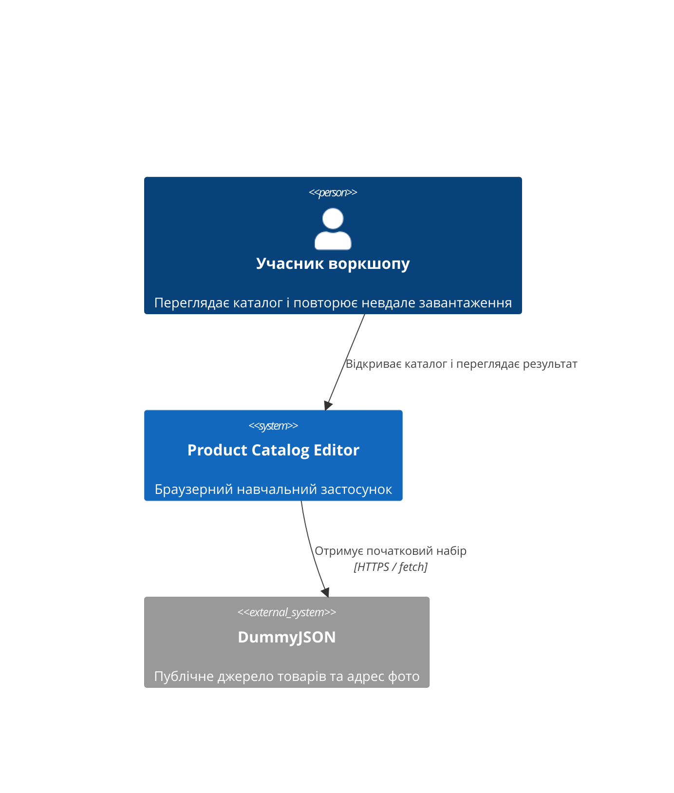
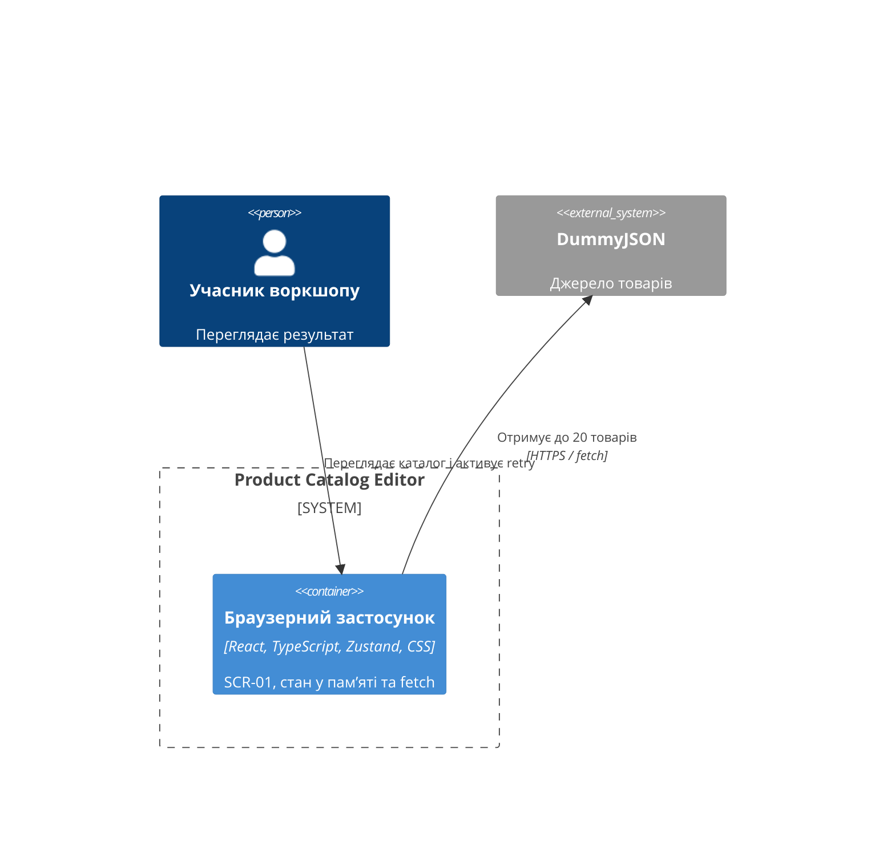
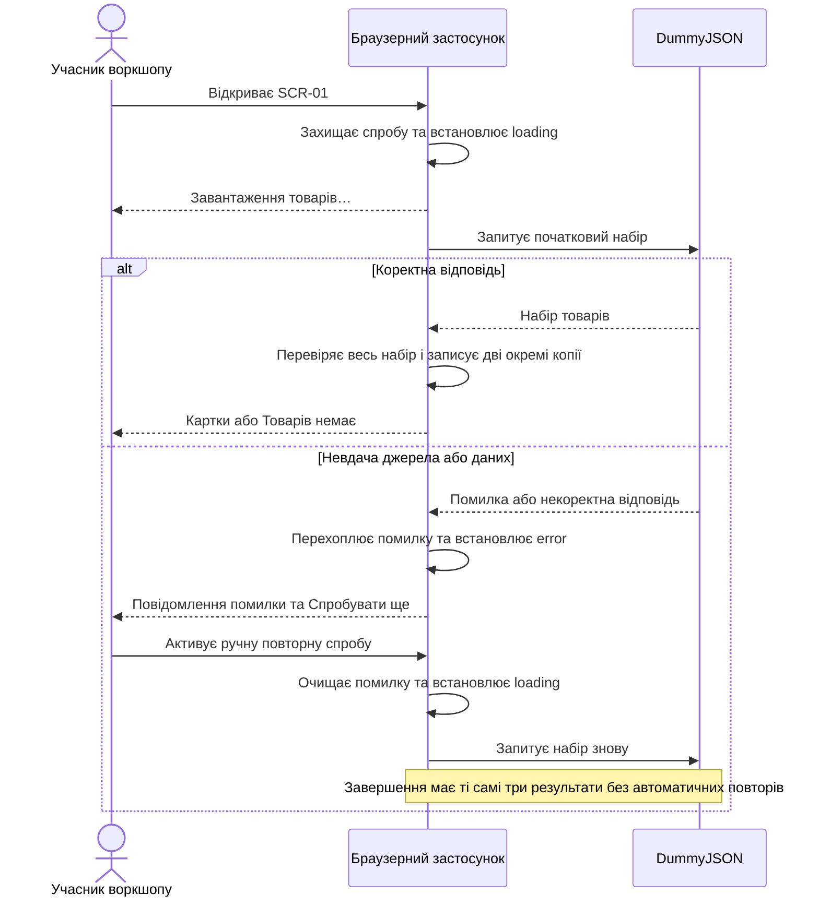

# Software Architecture Document — catalog-loading

## 1. Introduction and goals

Мінімальний технічний дизайн першого каталогу для **Учасника воркшопу**: автоматично отримати до 20 товарів, показати результат і дозволити ручну повторну спробу після помилки. Пріоритети: коректність усього набору, зрозумілі доступні стани, одна активна спроба.

Джерела: [spec](spec.md), [UX flows](ux-flows.md), [CONTEXT](CONTEXT.md), [architecture-map](../../architecture-map.md), [design-system](../../design-system.md), [ADR-001–003](../../adr/001-toolchain.md). Автор навчального проєкту визначає обсяг, Tech Lead перевіряє дизайн. Це документація майбутньої реалізації.

## 2. Constraints

React + Vite + strict TypeScript, Zustand, fetch і звичайний CSS; використовуємо встановлені залежності. Один модуль `src/features/catalog/`, прямі імпорти UI → model → api; API може імпортувати лише тип Product через `import type`, без залежності від store чи UI. Без barrel-файлів і універсальних шарів.

Без backend, авторизації, постійного сховища, роутера, UI kit і TanStack Query. Пошук, форма, редагування, видалення, reset, пагінація й оновлення успішного каталогу не входять у цей крок. Зберігаємо знімок, але не додаємо дій майбутніх кроків.

## 3. Context and scope

Карта описує матеріалізований skeleton, хоча `reflects_commit` передує його коміту. Зіставлено з `src/main.tsx` та `src/App.tsx`: StrictMode, мінімальний екран, бізнес-коду каталогу немає. Окремого повторного survey не потрібно. Згадка відсутньої design-system у старших UX-потоках історична; актуальні візуальні правила беремо з наявної design-system.



Учасник взаємодіє лише з браузерним застосунком; застосунок читає DummyJSON. Браузер окремо завантажує фото за адресами джерела; їхні збої не означають збій запиту каталогу.

## 4. Solution strategy

Поверхня `web-frontend`: наявна клієнтська React SPA, один SCR-01, без SSR і маршрутизації. Zustand володіє даними та життєвим циклом запиту; компоненти відображають стан. fetch і перевірка невідомої відповіді ізольовані в API.

**API.** `fetchProducts(): Promise<Product[]>` виконує GET `https://dummyjson.com/products?limit=20&skip=0`. Параметри обмеження та пропуску підтримує [документація DummyJSON](https://dummyjson.com/docs/products), перевірена 2026-10-03. Послідовність: перевірити `response.ok`, прочитати JSON як `unknown`, перевірити весь набір, повернути нові об’єкти лише з чотирма потрібними полями. Мережеві, HTTP, JSON та валідаційні помилки відхиляють Promise; API не формує UI-повідомлень.

Кореневий об’єкт має містити масив `products` довжиною 0–20. Кожен елемент — об’єкт: `id` є додатним цілим числом без повторів; `title` — рядок, для якого `trim()` непорожній; `price` — число, `Number.isFinite(price)` і `price >= 0`; `thumbnail` — рядок з абсолютною адресою, яку приймає `new URL()` і чий протокол `http:` або `https:`. Назву та адресу зберігаємо як у джерелі; `trim()` лише перевіряє назву. Зайві поля і метадані ігноруємо. Нічого не обрізаємо до 20 й не відкидаємо окремі некоректні товари: відхиляємо весь набір (AC-05).

**Store.** Єдина дія `loadProducts(): Promise<void>` допускає старт тільки з `idle` або `error`. Перевірка поточного статусу й синхронний перехід у `loading` відбуваються до першого `await`. Виклик у `loading` або `success` нічого не робить. Це захищає від подвійного ефекту StrictMode та повторних натискань. Під час відмонтування Catalog запит не скасовуємо і store не скидаємо: він належить вкладці й завершує ту саму спробу. Новий запит після успіху можливий лише після перезавантаження сторінки.

Нові стратегічні рішення не вводяться: SPA, структура й Zustand успадковані з ADR. Уточнення локальні та оборотні, порогу 2 із 3 критеріїв для нового ADR не досягають.

## 5. Building block view



Є один контейнер web-frontend; store та API — внутрішні модулі, не окремі сервіси.

| Запланований файл | Відповідальність |
|---|---|
| `src/App.tsx` | Наявні `main`, `h1`, `.app-shell`; композиція Catalog |
| `src/features/catalog/api/products.ts` | fetch, перевірка відповіді та перетворення на Product |
| `src/features/catalog/model/types.ts` | Product і CatalogStatus |
| `src/features/catalog/model/catalogStore.ts` | Zustand, дані, знімок, статус, помилка та loadProducts |
| `src/features/catalog/components/Catalog.tsx` | Ефект початкового завантаження, підписки на окремі поля store, список і блок стану |
| `src/features/catalog/components/ProductCard.tsx` | Фото, повна назва, ціна; локальний стан недоступності фото |
| `src/styles/base.css`, `src/styles/catalog.css` | Погоджені токени та стилі каталогу |

Мінімальний тип, наведений як контракт документації:

```ts
type Product = {
  id: number
  title: string
  price: number
  thumbnail: string
}
type CatalogStatus = 'idle' | 'loading' | 'success' | 'error'
```

Store: `products: Product[] = []`, `initialProducts: readonly Readonly<Product>[] = []`, `status: CatalogStatus = 'idle'`, `error: string | null = null`, дія `loadProducts`. Знімок має окремий масив і окремі копії кожного об’єкта, не ділить посилань із поточним каталогом; readonly позначає заборону його змін. Обидва набори записуються атомарно тільки після повної перевірки відповіді. Окремий store-прапорець `empty` не потрібний.

RetryButton із візуального інвентарю — нативний `button type="button"` усередині Catalog; окремий компонент без повторного використання не потрібний. ProductCard отримує `product`, список використовує `product.id` як React key. Ціну відображаємо через спільний `Intl.NumberFormat('en-US', { notation: 'standard', useGrouping: false, minimumFractionDigits: 2, maximumFractionDigits: 2 })`: два десяткові знаки з крапкою, без експоненційного запису, групування чи валюти для всіх скінченних невід’ємних чисел, включно з `1e21` і `Number.MAX_VALUE`. Назву відображаємо як текст у `h2`, без HTML-інтерпретації. Фото має `alt={product.title}`; `onError` перемикає локальний `useState` на «Фото недоступне» й прибирає зламаний `img`, не змінюючи store. У цьому кроці товар і адреса фото після успіху незмінні.

## 6. Runtime view

| Перехід | Дані та видимий стан SCR-01 |
|---|---|
| `idle` → `loading` | Ефект Catalog викликає loadProducts; порожні масиви, `error = null`; «Завантаження товарів…» |
| `error` → `loading` | Натискання «Спробувати ще» викликає ту саму дію; попередня помилка очищена, retry приховано |
| `loading` → `success` | Атомарно записані окремі копії каталогу й знімка, `error = null`; 1–20 карток або «Товарів немає» для `[]` |
| `loading` → `error` | Store перехоплює будь-яку помилку; обидва масиви порожні, повідомлення «Не вдалося завантажити товари. Спробуйте ще раз.» і retry |
| Виклик у `loading` / `success` | Без зміни стану й без нового запиту |

`idle` — внутрішній початковий стан; UI показує те саме очікування до запуску ефекту, без окремого екрана. Відмонтування й повторне монтування не запускають автоматичний retry з `error`: початковий ефект викликає дію лише коли актуальний статус `idle`.



Catalog зберігає один DOM-блок стану з `tabIndex={-1}` і ref. У loading/empty повідомлення має `role="status"`, у error — `role="alert"`; область каталогу має `aria-busy` для idle/loading. Після ручного retry та приховування кнопки ефект фокусує цей блок; початкове завантаження фокус не перехоплює. Блок зберігається після success навіть без видимого повідомлення, щоб фокус не втрачався. Картки — семантичний список `ul`/`li`; повідомлення й retry взаємовиключні зі списком.

## 7. Deployment view

<!-- N/A: використовується наявний браузерний Vite-застосунок, змін інфраструктури немає. -->
Дані живуть у пам’яті вкладки; перезавантаження створює новий store й нове початкове завантаження. Нових сервісів, телеметрії, CI та правил масштабування немає.

## 8. Crosscutting concepts

| Concept | Convention | Source |
|---|---|---|
| Межа довіри | JSON є unknown до перевірки; зайві поля не зберігаємо, назви відображаємо текстом | spec AC-05, §6.1 |
| Помилки | API відхиляє Promise, store зберігає лише погоджений український текст; UI не показує технічних деталей | ADR-003, spec AC-04 |
| Ідентичність і дані | Числові id джерела; незмінні операції та окремий початковий знімок | ADR-003 |
| Доступність і стилі | Семантичний HTML, клавіатурний retry, live-повідомлення, керування фокусом і наявні CSS-токени | design-system |
| Публічний доступ | Без входу, персональних даних і серверного запису | spec AC-07, §6.1 |

## 9. Architecture decisions

| ADR | Title | Status | Section |
|---|---|---|---|
| [001](../../adr/001-toolchain.md) | Навчальний frontend toolchain | Accepted | §2, §4 |
| [002](../../adr/002-catalog-module.md) | Один модуль каталогу | Accepted | §2, §5 |
| [003](../../adr/003-ephemeral-state.md) | Локальний каталог і відокремлена чернетка | Accepted | §4–6 |

Нових feature ADR немає; каталог `catalog-loading/adr/` не створюється. Таблиця посилається тільки на чинні файли. Наявні згадки чернетки та reset у ADR не розширюють обсяг.

## 10. Quality requirements

| When | Then | How verify |
|---|---|---|
| Завантаження та повторні активації | «Не більше 1 активної спроби завантаження на вкладку; 0 автоматичних повторів» | Store з керованим Promise, повторні виклики, монтування у StrictMode та remount після error |
| Клавіатурний retry й повідомлення | «100% активацій retry можливі клавіатурою; повідомлення очікування й помилки доступні допоміжним технологіям; кожне фото має опис» | Компонентні тести семантики, Enter/Space, ref-фокус після retry; браузерна перевірка |
| Відображення, зокрема довгої назви | «0 горизонтального прокручування екрана на ширинах 320 і 1280 CSS-пікселів, зокрема з довгою назвою» | Ручна перевірка за design-system: контейнер до 960px, колонки 1/2/3, перенос слів, фото 160px |
| Автоматизовані перевірки | «0 реальних мережевих звернень у автоматизованих тестах; 100% сценаріїв §5 мають перевірку» | Підміна fetch, ізоляція store, Test plan у spec; тести поруч із модулями |

Числові вимоги процитовано з spec §6. API-тести охоплюють 20/менше/0 товарів, кожну помилку AC-05, HTTP, мережу й JSON. Store-тести перевіряють переходи, захист спроби та відсутність спільних посилань каталогу зі знімком. UI-тести — усі стани, три результати retry, дані картки та локальний збій фото. Під час реалізації адаптуємо наявний smoke-тест App до підміненого fetch; тести зараз не пишемо.

## 11. Risks and technical debt

| Risk / debt | Severity | Mitigation | Owner |
|---|---|---|---|
| DummyJSON недоступний або відповідь змінилася | Medium | Повна перевірка набору, error і ручний retry, без запасних даних | Автор навчального проєкту |
| Запит довго не завершується | Low | Зберігаємо loading і захист однієї спроби; timeout, SLO й автоматичний retry не погоджені та не додаються | Автор навчального проєкту |
| Фото недоступне після успішної перевірки адреси | Low | Локальна заміна в ProductCard, без помилки каталогу | Автор навчального проєкту |

Блокувальних відкритих питань немає. Постійне збереження, CI та функції наступних кроків не є боргом цього дизайну.

## 12. Glossary

Канонічні визначення: [CONTEXT — Glossary](CONTEXT.md#glossary).

| Term | Meaning |
|---|---|
| Учасник воркшопу | Автор навчального проєкту, який переглядає каталог і практикує Codex та SDD |
| Товар / Product | Позиція джерела з id, title, price, thumbnail |
| Каталог | Поточний завантажений набір у пам’яті вкладки, не весь асортимент джерела |
| Картка | Представлення одного товару з фото, назвою та ціною |
| Початковий знімок | Окрема незмінна копія успішно завантаженого каталогу для майбутнього скидання |
| Повторна спроба | Нове завантаження після невдачі, не автоматичний повтор і не оновлення успішного каталогу |
| Empty | Відображення `success` із порожнім масивом, не окремий статус store |

## Assumptions / decisions ledger

- Явні вказівки автора: quick / easy, мінімальний дизайн, українська мова, лише документація, погоджена структура та відсутність нових залежностей.
- Easy-defaults для review: одна дія loadProducts із захистом статусом; початковий ефект лише для idle; без скасування запиту на unmount; окремі копії знімка; retry як нативна кнопка в Catalog; збій фото у useState картки. Успадковані вимоги й нові технічні уточнення розділено в §2–5.
- Edits-log: авторських Edit / Drop / Save-as-OQ під час цього проходу немає. Уточнення не змінюють upstream-документи чи локальні налаштування SDD.
- ADR-spawns log: порожній; рішення спираються на ADR-001–003, нових рішень із достатнім масштабом впливу немає.
