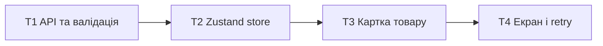

# Epic — catalog-loading

> [Spec](../spec.md) · [Design](../sad.md) · [UX flows](../ux-flows.md) · [Screens](../screens.md) · [ADRs](../../../adr/001-toolchain.md)

## Goal

Показати до 20 перевірених товарів, доступні стани й ручний retry. Size S, route quick, depth easy. Лише план; вихідні документи Draft, їхній статус не змінюємо. Чинні Accepted ADR-001–003 розташовані у docs/adr, відповідно до sad §9.

## Scope

- In: fetch і валідація, Zustand та окремий знімок, картки, SCR-01 і перевірки на наявних Vitest/RTL.
- Out: пошук, форма, зміни товарів, reset, нові залежності, backend і постійне сховище.

## Task map

Чотири послідовні задачі за запитом автора. Типи включені в першого споживача; T3/T4 мають спільний catalog.css. Кожна задача — одна невелика сесія, орієнтовно 2–4 години, максимум день; оцінки не є дедлайном.

## Tasks

[Tracker](tracker.md) · [tasks.json](../tasks.json)

| # | Task | Layer | Blocked by | DoD (short) |
|---|---|---|---|---|
| T1 | [Отримати й перевірити весь набір товарів](fetch-and-validate.md) | infra | — | Vitest API: усі валідні набори повертають нові об’єкти з чотирма полями, усі невалідні набори та збої відхиляються цілком; назва й URL збережені без нормалізації. |
| T2 | [Керувати завантаженням і знімком у Zustand](catalog-store.md) | app | T1 | Vitest store: idle/error → loading → success/error, максимум одна активна спроба, жодного автоматичного retry або запиту після success; каталог і readonly-знімок не ділять масив чи об’єкти. |
| T3 | [Показати картку та заміну недоступного фото](product-card.md) | ui | T2 | React Testing Library: точні назва/src/alt/ціна, HTML у назві залишається текстом; збій одного img дає локальну заміну без загальної помилки. |
| T4 | [Зібрати екран каталогу зі станами та ручним retry](catalog-screen.md) | ui | T3 | Vitest + RTL App/Catalog: усі стани SCR-01 і три результати retry, одна спроба у StrictMode, remount без автоматичного retry, доступна семантика й фокус; браузер: Enter/Space та ширини 320/1280px. |

## Risks / Hard rules

UI → model → api; API імпортує лише тип Product. Одна активна спроба, без автоматичних повторів. Знімок не ділить посилань із каталогом. Локальний збій фото не є помилкою каталогу. Тести ізольовані й без мережі. Повторно використовуємо App, base.css, токени та компоненти інвентарю design-system; RetryButton не потребує окремого компонента.

## Verification

AC-01–10 покрито; тестові перевірки включено в DoD кожної задачі та узгоджено з spec Test plan. Для quick окремий plan-tests можна пропустити. Клавіатурну активацію та layout перевірити в браузері; jsdom не замінює ці перевірки. Реалізацію не запускати в цій стадії.
