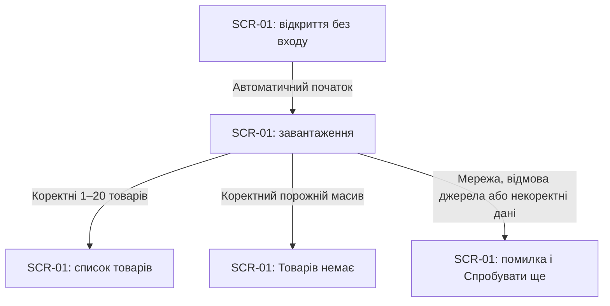
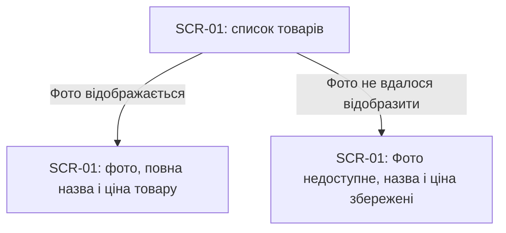
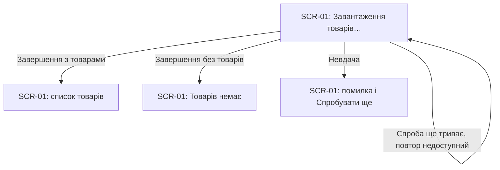
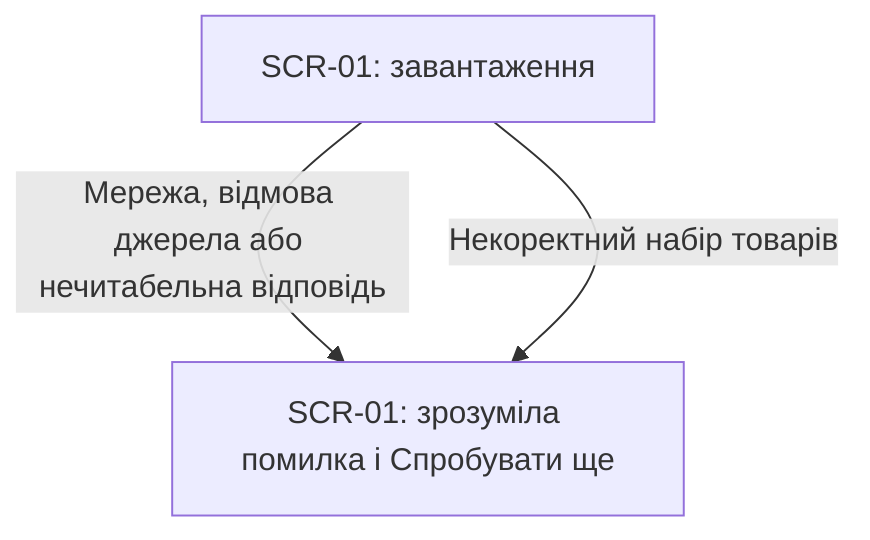
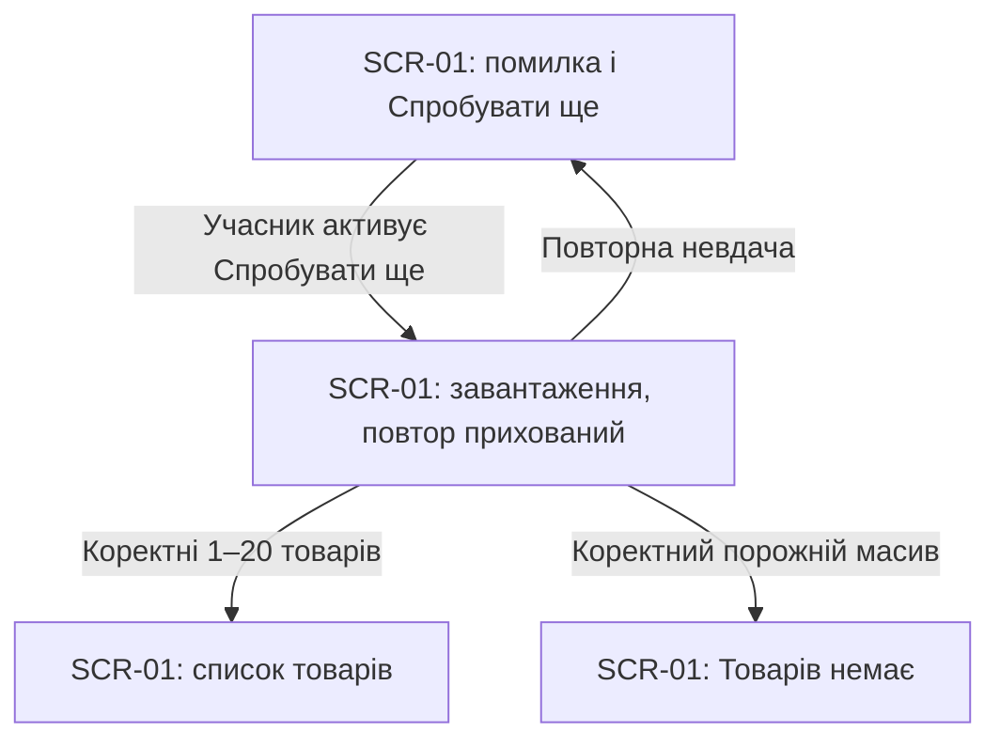

# UX flows — catalog-loading

Джерела: [spec](spec.md) §4–6, [architecture-map](../../architecture-map.md), [CONTEXT](CONTEXT.md). Route **quick**, depth **easy**; `.route`, `.size` і локальні налаштування не змінюємо. Лише документація.

## Platform decisions

- Браузерний застосунок, один екран без переходів на інші сторінки й без входу. Учасник воркшопу відкриває каталог і переглядає результат автоматичного завантаження.
- Адаптивний перегляд на 320 і 1280 CSS-пікселях без горизонтального прокручування, відповідно до spec §6. `docs/design-system.md` відсутній; працюємо з припущенням code-mode, без вибору компонування, компонентів чи стилів.
- Усі результати завантаження змінюють стан SCR-01. Єдина дія після невдачі — ручна повторна спроба на цьому самому екрані.
- Пошук, редагування, видалення, скидання, сортування, пагінація й оновлення успішного каталогу поза обсягом. Згадки наступних функцій у карті архітектури не розширюють цю специфікацію.

## Screen inventory

| ID | Екран | Призначення | Вхід | Вихід |
|---|---|---|---|---|
| SCR-01 | Початковий каталог | Переглянути товари або зрозуміти результат завантаження | Відкриття чи перезавантаження застосунку без входу | Перехід між станами цього самого екрана; інших екранів у межах функції немає |

### Стани SCR-01

| Стан | Що бачить учасник | Доступна дія / наступний стан |
|---|---|---|
| Завантаження | «Завантаження товарів…»; карток і попередньої помилки немає | Очікування; «Спробувати ще» прихована. Завершення веде до списку, порожнього результату або помилки |
| Список товарів | Від 1 до 20 карток у порядку джерела; повна назва, фото з описом із назвою товару, ціна джерела з двома десятковими знаками без припущеної валюти | Перегляд; очікування, помилки й кнопки повтору немає |
| Порожній результат | «Товарів немає»; карток, очікування, помилки й кнопки повтору немає | Перегляд завершено; автоматичного повтору немає. Це коректний порожній масив від джерела |
| Помилка | «Не вдалося завантажити товари. Спробуйте ще раз.» і кнопка «Спробувати ще»; без карток, очікування й технічних деталей | Активація кнопки, зокрема клавіатурою, повертає до завантаження |
| Недоступне фото у списку | «Фото недоступне» замість фото одного товару; його назва, ціна й решта карток доступні | Перегляд триває; стан успішного каталогу зберігається, загальної помилки немає |

Недоступне фото — локальний випадок у списку, не п’ятий стан запиту чи новий екран. Початковий `idle` не потребує окремого користувацького кроку: відкриття автоматично починає завантаження. Повідомлення очікування й помилки мають бути доступні допоміжним технологіям (spec §6).

## Flows

### Flow: US-01 — Відкрити початковий каталог

Учасник відкриває застосунок без входу й бачить очікування. Коректний непорожній набір показує всі отримані товари в порядку джерела; коректний порожній масив — «Товарів немає». Недоступне джерело або некоректна відповідь дає помилку з повторною спробою, без часткового каталогу, демонстраційних даних чи даних попередньої сесії. Перезавантаження сторінки починає цей потік заново.

### Flow: US-02 — Переглянути дані товару

Учасник бачить фото відповідного товару з текстовим описом, повну назву та ціну джерела з двома десятковими знаками, без перерахунку чи валюти. Якщо саме відображення фото не вдалося, з’являється «Фото недоступне»; назва, ціна та інші картки лишаються доступними. Некоректна адреса фото у відповіді належить до помилки даних за AC-05, а не до цієї гілки.

### Flow: US-03 — Розуміти очікування завантаження

Під час початкової чи повторної спроби видно лише повідомлення очікування без карток і попередньої помилки. Кнопка повтору прихована, тому ще одну спробу почати неможливо. Після завершення очікування замінюється списком, порожнім результатом або помилкою. Петля означає продовження очікування, а не автоматичний повтор запиту.

### Flow: US-04 — Зрозуміти невдале завантаження

Невдача мережі, відмова джерела, нечитабельна відповідь або некоректний набір ведуть до однакового повідомлення «Не вдалося завантажити товари. Спробуйте ще раз.» і кнопки «Спробувати ще». Некоректний набір охоплює понад 20 товарів, повторні ідентифікатори, хоча б один некоректний товар, відсутній список чи неправильний формат за AC-05. Часткового списку й технічного тексту помилки немає; запасні дані не підставляються.

### Flow: US-05 — Повторити невдале завантаження

Учасник активує «Спробувати ще» мишею або клавіатурою без перезавантаження сторінки й без входу. Попередня помилка зникає, видно очікування; паралельна спроба недоступна. Успіх показує актуальний список або порожній результат; повторна невдача повертає помилку й дозволяє наступну ручну спробу. Автоматичного повтору немає.

Усі US-01–US-05 стосуються UI; історій лише для серверної частини немає.

## AC coverage

| AC | Потік / вузол / гілка | Примітка |
|---|---|---|
| AC-01 | US-01: A–L–C | Автоматичний початок, 1–20 карток, порядок джерела; кінцевий стан у таблиці SCR-01 |
| AC-02 | US-02: C–P | Фото й опис, повна назва, ціна з двома десятковими знаками без валюти |
| AC-03 | US-03: L–L; US-05: E–L | Очікування без карток і попередньої помилки; повтор прихований до завершення |
| AC-04 | US-04: L–E | Точний текст помилки та доступна кнопка, без технічних деталей |
| AC-05 | US-04: L–E, гілка некоректного набору | Відхилення всього набору за правилами spec, без часткового каталогу |
| AC-06 | US-05: E–L–C / Z / E | Три результати повтору; наступна ручна спроба після повторної невдачі |
| AC-07 | US-01: A; US-05: E–L | Публічний доступ без входу й перевірки ролей |
| AC-08 | US-01: L–E; US-04: L–E; US-05: E–L–C / Z | Без запасних даних; ручне відновлення після доступності джерела |
| AC-09 | US-02: C–F | Локальна заміна фото, збереження решти даних і успіху каталогу |
| AC-10 | US-01: L–Z; US-05: L–Z | Порожній масив; без карток, очікування, помилки й повтору |

## Assumptions / decisions ledger

- Явні вказівки автора: quick / easy, українська мова, один екран і лише документація; обсяг наступних кроків не включено.
- Припущення для review: адаптивний браузерний перегляд і code-mode за відсутності design-system; підстава — spec §6 і наявна карта архітектури. Окремого візуального рішення не ухвалено.
- Easy-default для review: під час завантаження кнопку повтору приховуємо; AC-03 дозволяє цей варіант. Це не нова вимога до інших функцій.
- US-01: відкриття автоматично веде до очікування, потім до списку, порожнього результату або помилки.
- US-02: недоступне фото замінюється локально, решта успішного каталогу зберігається.
- US-03: очікування блокує повтор до завершення поточної спроби.
- US-04: усі визначені помилки завантаження й даних дають однакове зрозуміле повідомлення з повтором.
- US-05: ручний повтор повертає до очікування й має три результати; повторна невдача дозволяє наступну ручну спробу.
- Діаграми описано прозою й записано без окремого підтвердження кожної на depth easy. Нових блокувальних питань немає.
