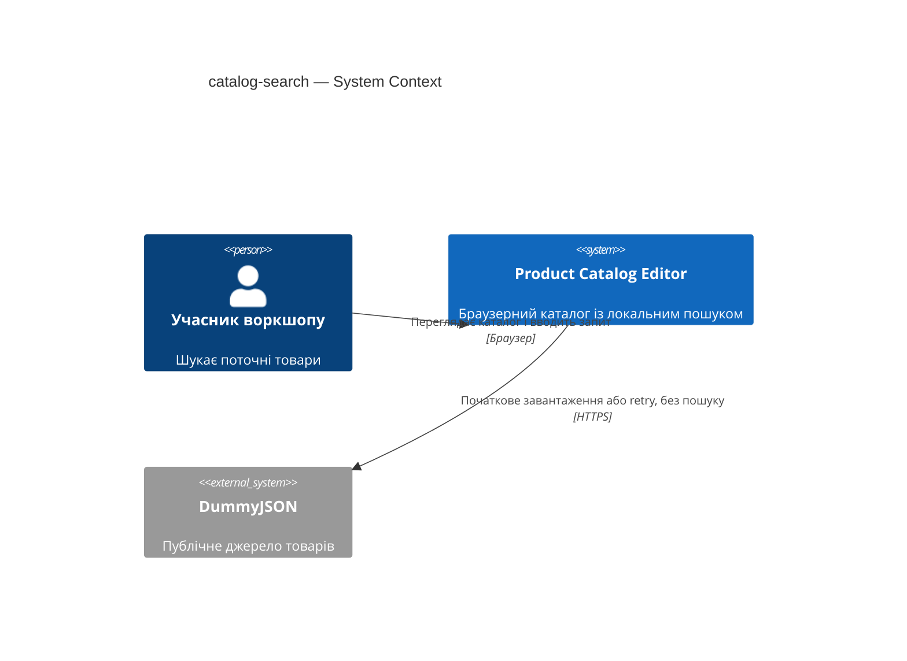
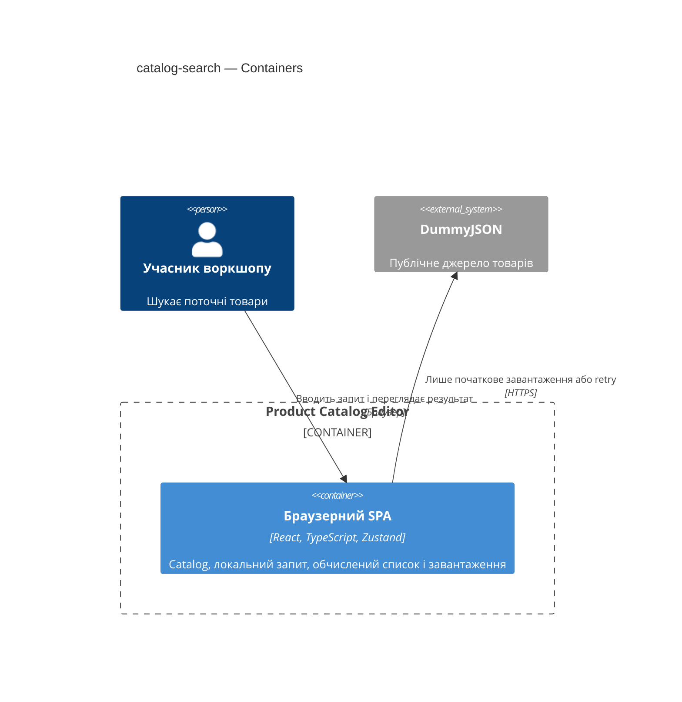
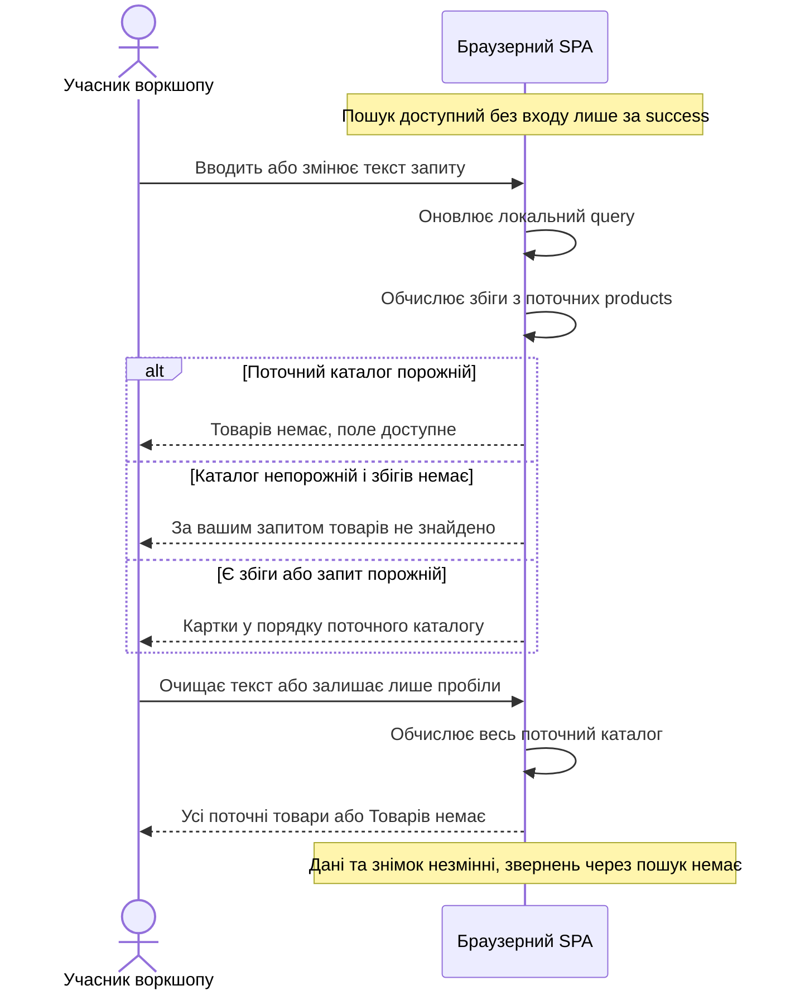

# Software Architecture Document — catalog-search

Джерела: [spec](spec.md), [CONTEXT](CONTEXT.md), [UX flows](ux-flows.md), [architecture-map](../../architecture-map.md), [design-system](../../design-system.md), чинні ADR-001–003. Route **quick**, depth **easy**. Мова відповідає сусіднім документам функції. Це дизайн майбутньої зміни, не реалізація.

## 1. Introduction and goals

**Intent.** Учасник воркшопу знаходить товари за частиною назви в поточному каталозі без нового завантаження. Пошук змінює видимий список, зберігаючи каталог і початковий знімок.

**Top-3 quality goals:**
1. Цілісність даних та відсутність додаткових мережевих звернень.
2. Коректне обчислення збігів із поточних товарів без підтвердження вводу.
3. Доступність клавіатурою й однозначне розрізнення станів екрана.

| Role | Interest | Sign-off owner? |
|---|---|---|
| Учасник воркшопу | Пошук і навчальна практика | No |
| Tech Lead | Узгодженість архітектури та перевірок | Yes |

Decision overrides: немає.

## 2. Constraints

**Technical.** React 19.3, Vite 8.3, TypeScript 6.0 strict, Zustand 5.0; npm і Node.js 22.12+. Точні версії визначає package-lock.json. Один SPA-екран, звичайний CSS. Без backend, роутера, авторизації, localStorage, UI kit і TanStack Query. Дані та початковий знімок залишаються в Zustand у пам’яті вкладки.

**Organisational.** Навчальний проєкт; XS і один очікуваний PR є оцінкою масштабу. Підтвердженого дедлайну чи жорсткого бюджету немає; нові строки не встановлюємо. CI поза першою версією.

**Conventions.** [AGENTS.md](../../../AGENTS.md), [ADR-002](../../adr/002-catalog-module.md): прямі імпорти UI → model → api, тести поруч із модулями, PascalCase компонентів, camelCase функцій, семантичний HTML і пов’язаний label. API не імпортує UI/store. Нових залежностей і універсальних шарів немає.

**Regulatory / external.** За spec §6.1 дані public, персональних даних немає. Запит не передається джерелу, аналітиці чи сховищу. Текст обробляється буквально без виконання коду.

## 3. Context and scope

Пошук охоплює лише вже завантажений каталог до 20 товарів. Завантаження, перевірка відповіді й retry належать catalog-loading. Межа довіри до зовнішніх товарів залишається в api/products.ts; пошук працює з нормалізованими Product.

<!-- brownfield: stale map rescanned by explorer on 2026-10-03 at f8a60cd; catalog-loading implemented -->
Карта ще описує skeleton; поточні Catalog, ProductCard, catalogStore і API вже реалізовані. docs/design-system.md існує, попри застарілу примітку в UX flows; його code-mode та CSS-конвенції успадковуються.

| Actor or system | Type | Interaction |
|---|---|---|
| Учасник воркшопу | Person | Вводить, змінює та очищає запит |
| DummyJSON | External system | Лише початкове завантаження і retry, без пошукових звернень |



Контекст: Учасник воркшопу працює з Product Catalog Editor, а застосунок звертається до DummyJSON лише для завантаження.

## 4. Solution strategy

1. **Target surface: web-frontend.** Продовжуємо SCR-01 у браузері; інших поверхонь немає. Це успадкований вибір, підтверджений spec і UX inventory.
2. **UI architecture: існуючий SPA.** Catalog утримує сирий текст запиту в useState, початкове значення `''`; підписка на products залишається реактивною. Поле з label «Пошук за назвою» показується лише за status success, включно з порожнім каталогом. Його DOM-вузол і фокус зберігаються під час зміни результатів. Без submit, debounce, маршрутизації чи нового стану store.
3. **Обчислений видимий список.** Чиста функція `filterProductsByTitle(products, query)` у model/search.ts нормалізує запит через `trim().toLowerCase()`, перевіряє `title.toLowerCase().includes(normalizedQuery)`. Порожній нормалізований запит повертає всі поточні товари. Внутрішні пробіли, лапки, розмітка та символи шаблонів буквальні; regex і HTML-інтерпретації немає. Порядок і поля товарів не змінюються, початковий знімок не читається для пошуку.
4. **Пріоритет результатів.** idle/loading і error з retry залишаються чинними. За success спершу перевіряємо products.length: нуль означає «Товарів немає» за будь-якого запиту. Лише непорожній каталог із нульовим видимим списком означає «За вашим запитом товарів не знайдено», без retry. Решта показує картки видимого списку.

Усі рішення оборотні всередині одного catalog-модуля. Для поверхні та SPA альтернативи виключені чинними обмеженнями; для розміщення чистої функції чесна альтернатива — inline у Catalog, але це лише один критерій gate. Inline зберігається як тактичне рішення, новий ADR не створюється.

## 5. Building block view

Розширюємо наявний модуль catalog: UI читає поточні products і статус із store та викликає чисту model-функцію. Пошук не викликає loadProducts або API. Store і API не змінюють контракт. Обчислення виконується на кожному рендері з актуальними products/query, без дубльованого стану та effect для синхронізації.

```text
src/features/catalog/
├── api/products.ts               наявне завантаження, без змін
├── model/catalogStore.ts         наявні products/initialProducts/status/error
├── model/search.ts               нова чиста filterProductsByTitle
├── model/search.test.ts          майбутні перевірки правила
├── components/Catalog.tsx        поле, локальний query, обчислений список
├── components/Catalog.test.tsx   майбутні перевірки взаємодії та інваріантів
└── components/ProductCard.tsx    повторне використання наявної картки
src/styles/catalog.css           стилі поля за чинним CSS-підходом
```



Є один container для web-frontend. Zustand, model-функція й компоненти — внутрішні частини SPA, не окремі сервіси чи бази даних.

## 6. Runtime view

**Critical flow: локальне введення і повторне обчислення (AC-01–AC-04, AC-06–AC-07).**



Для локального правила достатньо одного SPA-учасника та самовикликів: додатковий сервіс був би вигаданим. За idle/loading/error поля немає; чинні повідомлення й retry зберігаються. AC-05: коли інша функція незмінно замінить products, підписка Zustand спричинить рендер і те саме обчислення з чинним query. UI редагування/видалення тут не додаємо.

Окрема sequences-стадія N/A: один актор, чисте синхронне правило в одному контейнері, без багатокрокового міжсистемного процесу. Таблиця §10 та цей текст покривають AC-01–AC-07.

## 7. Deployment view

<!-- N/A: reuses existing deployment unit, no infra change -->
Пошук входить у поточний Vite build і виконується в пам’яті браузера. Нових процесів, інфраструктури, серверних метрик або порогів масштабування немає.

## 8. Crosscutting concepts

| Concept | Convention | Where defined |
|---|---|---|
| State / IDs | products і initialProducts у Zustand, id джерела як React key; query у useState | ADR-003, §4 |
| Error handling | Нуль збігів — результат пошуку, не error і не retry | spec AC-03, AC-07 |
| Authentication | Входу й додаткових дозволів немає | spec AC-06 |
| Security / privacy | Буквальний includes, стандартне React-екранування, без regex/dangerouslySetInnerHTML або передачі запиту | spec §6.1 |
| Accessibility | Видимий пов’язаний label, введення/очищення клавіатурою, видимий фокус, незмінний вузол поля; no-match у role=status | spec §6, UX flows |
| Styling / language | Звичайний CSS, українські повідомлення, назви товарів із джерела | design-system |
| Observability / events | Нової телеметрії, подій та логування запиту немає | spec §7, §6.1 |
| Retry focus | Постійний statusBlock і чинний механізм фокусу після retry зберігаються | Catalog.tsx, catalog-loading |

## 9. Architecture decisions

Нових ADR немає: жодне рішення не досягло 2 із 3 критеріїв (незворотність ≥3 днів, зміна контракту ≥2 модулів, чесні альтернативи). Орієнтир 2–4 ADR для XS не є підставою дублювати вже прийняті рішення. `catalog-search/adr/` не створюється; індекс нових ADR порожній і замкнений.

| # | Title | Status | Section |
|---|---|---|---|

**Inherited decisions (поза feature adr/):**
- [ADR-001](../../adr/001-toolchain.md) — toolchain і локальні перевірки; Accepted; §2.
- [ADR-002](../../adr/002-catalog-module.md) — один модуль і прямі залежності; Accepted; §2, §5.
- [ADR-003](../../adr/003-ephemeral-state.md) — тимчасовий стан і окремий знімок; Accepted; §4, §8.

## 10. Quality requirements

Цілі spec §6 наведено дослівно; наведені перевірки — план для реалізації, не звіт про вже реалізований пошук.

| Goal / AC | When | Then — target from spec §6 | How verify |
|---|---|---|---|
| QG-1 / AC-04 | Введення, зміна, нуль збігів і очищення після завантаження | 0 додаткових звернень через пошук | Зафіксувати кількість викликів підміненого fetch після завантаження й порівняти після дій |
| QG-1 / AC-04 | Та сама серія дій | 0 змін каталогу та початкового знімка | Порівняти всі поля, кількість і порядок обох масивів до/після |
| QG-2 / AC-01–AC-03, AC-05, AC-07 | Пошук у порожньому, малому та граничному поточному наборі | Коректний результат для 0–20 товарів | Unit: регістр, крайні/внутрішні пробіли, порожній текст, буквальні символи, порядок; компонент: нуль збігів проти порожнього каталогу, незмінний query після заміни products і актуальні назви |
| QG-2 / AC-01–AC-02 | Учасник вводить чи очищає текст | 0 додаткових дій після введення тексту для оновлення списку | Компонентне введення без submit/Enter, перевірка видимих карток |
| QG-3 / AC-06–AC-07 | Успіх завантаження, пошук без входу | 1 видима пов’язана мітка поля; 100% пошукових дій доступні клавіатурою | getByRole за назвою «Пошук за назвою», label association; ручні Tab, введення, Ctrl+A/Cmd+A, Delete/Backspace, збереження фокусу й вихід Tab |

Додатково компонентні перевірки зберігають loading/error/retry і відсутність поля до success (AC-07), точний no-match без retry (AC-03), поле при success із порожнім каталогом (AC-07). Store ізолюється між тестами; мережа підміняється. Ручні перевірки доступності виконуються під час реалізації.

## 11. Risks and technical debt

| Risk / debt | Severity | Mitigation | Owner |
|---|---|---|---|
| Карта архітектури та inventory design-system описують skeleton, UX помилково каже що design-system відсутній | Low | У цьому SAD використано фактичний код та explorer; оновити карту через survey перед ширшими змінами | Tech Lead |
| Сплутати products.length і довжину видимого списку | Low | Першим перевіряти поточний каталог; компонентні сценарії AC-03/AC-07 | Автор навчального проєкту |
| Майбутня функція мутує products на місці або зберігає копію результатів | Low | Незмінні оновлення store і обчислення з актуального products/query; перевірка AC-05 через заміну масиву | Автор навчального проєкту |

**Accepted debt.** Семантика простого lower-case підрядка не включає приблизні збіги чи спеціальну мовну нормалізацію; це межа spec, не прихована вимога. Немає нових відкритих архітектурних питань і save_as_oq, тому рядки Open question з owner/due не потрібні. Дедлайн функції не встановлено й не блокує дизайн.

## 12. Glossary

Канонічне джерело — [CONTEXT.md](CONTEXT.md); значення не перевизначаються.

| Term | Meaning |
|---|---|
| Учасник воркшопу | Автор навчального проєкту, який переглядає каталог і практикує Codex та SDD |
| Товар | Позиція джерела з числовим ідентифікатором, назвою, ціною та адресою фото |
| Каталог | Поточний набір завантажених товарів у пам’яті вкладки, не весь асортимент джерела |
| Картка | Представлення одного товару з фото, назвою й ціною |
| Початковий знімок | Окрема незмінна копія успішно завантаженого каталогу для майбутнього скидання, не поточний каталог |
| Пошуковий запит | Текст поля; регістр і крайні пробіли ігноруються, внутрішні пробіли враховуються |
| Збіг | Назва містить запит як суцільний підрядок без урахування регістру |
| Видимий список | Обчислений результат серед поточних товарів у їхньому порядку, не окремий збережений каталог |

