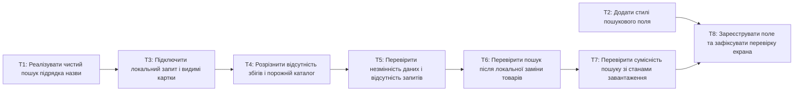

# Epic — catalog-search

> **Spec:** [spec.md](../spec.md) · **Design:** [sad.md](../sad.md) · **Screens:** [screens.md](../screens.md) · **ADRs:** [adr/](../../../adr/). DB і зовнішній API N/A.

## Goal

Локальний пошук поточних товарів за назвою без додаткового fetch та змін даних. XS, route quick; 8 вузьких задач за контрактом tasks, сумарно близько 5 годин як оцінка, не дедлайн.

## Scope

- **In:** model/search, Catalog, CSS, перевірки та inventory.
- **Out:** backend, міграції, серверний пошук, UI редагування/видалення/reset.

## Task map

T2 можна реалізувати паралельно T1; його ручний тест і закриття чекають T3 (verification-only, не production залежність). T3–T7 мають спільну lane через Catalog.test.tsx. Спільні типи Product/store не змінюються, compile-coupled lane не потрібна.

## Tasks

Статуси: [tracker.md](tracker.md). Контракт: [tasks.json](../tasks.json).

| # | Task | Layer | Blocked by | DoD (short) |
|---|---|---|---|---|
| T1 | [Реалізувати чистий пошук підрядка назви](title-filter.md) | domain | — | Unit-тести search.test.ts перевіряють регістр, пробіли, буквальні символи, порядок, 0–20 товарів і незмінність вхідних даних. |
| T2 | [Додати стилі пошукового поля](search-styles.md) | ui | — | Ручна браузерна перевірка поля на 320/1280px підтверджує відсутність горизонтального прокручування, висоту 44px і видимий фокус; виконується після T3. |
| T3 | [Підключити локальний запит і видимі картки](search-input.md) | ui | T1 | Компонентні тести Catalog.test.tsx підтверджують пов’язаний label, пошук без submit, порядок карток, очищення і відкритий доступ. |
| T4 | [Розрізнити відсутність збігів і порожній каталог](result-states.md) | ui | T3 | Компонентні тести Catalog.test.tsx перевіряють точні повідомлення, role=status, відсутність retry для no-match і відновлення списку. |
| T5 | [Перевірити незмінність даних і відсутність запитів](search-invariants.md) | tests | T4 | Компонентний тест Catalog.test.tsx порівнює всі поля, кількість і порядок products/initialProducts та лічильник fetch до і після серії пошукових дій. |
| T6 | [Перевірити пошук після локальної заміни товарів](current-products.md) | tests | T5 | Компонентний тест Catalog.test.tsx із заміною store.products в act підтверджує актуальні назви, видалені товари, збереження query і незмінний знімок. |
| T7 | [Перевірити сумісність пошуку зі станами завантаження](loading-compatibility.md) | tests | T6 | Компонентні тести Catalog.test.tsx підтверджують приховане поле до success, error/retry/loading, aria-busy і пріоритет catalog-empty за будь-якого query. |
| T8 | [Зареєструвати поле та зафіксувати перевірку екрана](verification-and-inventory.md) | docs | T2, T7 | verification.md містить результати ручного тесту SCR-01 на 320/1280px, Tab/очищення/збереження фокусу, а build, всі тести й lint проходять. |

## Risks / Hard rules

> Зберігаємо один екран та наявні стани завантаження. За картою архітектури запит є локальним станом компонента, видимий список обчислюється з актуального каталогу й не зберігається дублем у store. Нових залежностей, зовнішніх контрактів або міграцій немає.

— `spec.md §2, Constraints, verbatim` · [spec.md](../spec.md).

Пріоритет products.length над видимим списком; карта/inventory застарілі, фактичні Catalog і ProductCard вже існують.

— `sad.md §11, risks, abridged` · [sad.md](../sad.md).
