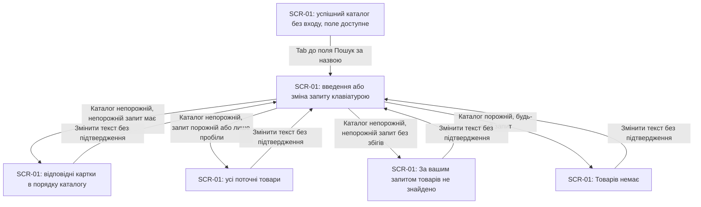
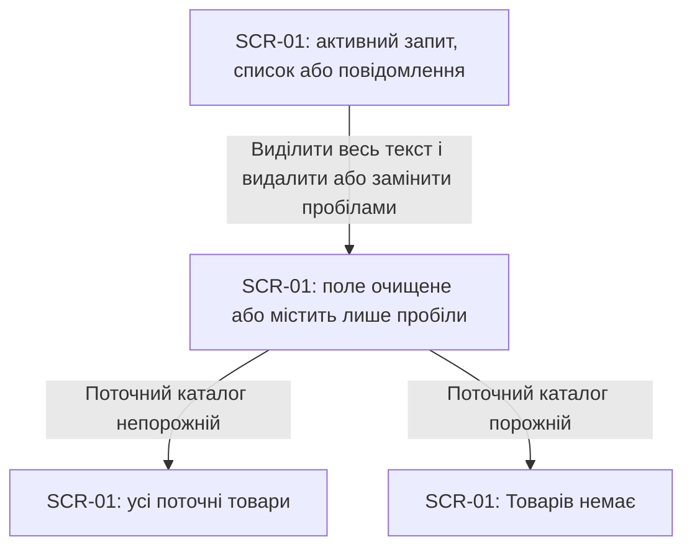
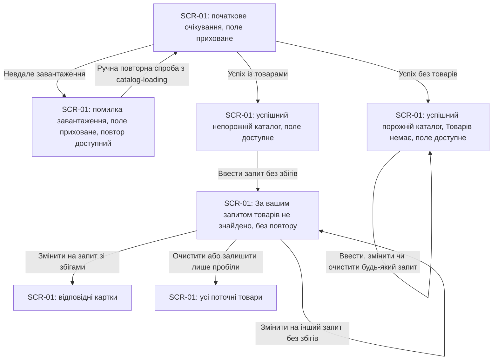
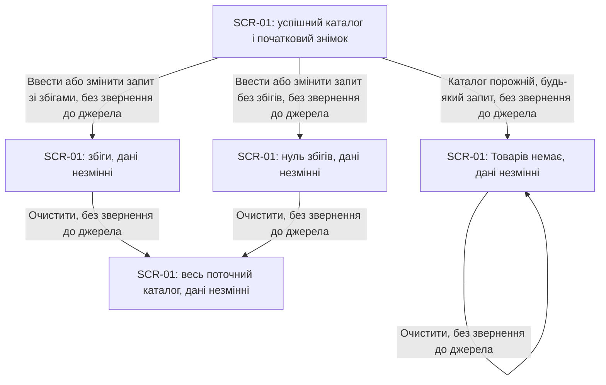
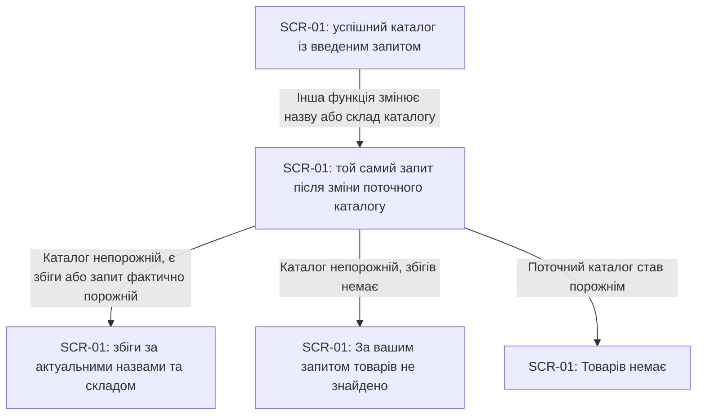

# UX flows — catalog-search

Джерела: [spec](spec.md) §4–6, [CONTEXT](CONTEXT.md), [catalog-loading UX flows](../catalog-loading/ux-flows.md), [architecture-map](../../architecture-map.md). Route **quick**, depth **easy**, розмір **XS**; `.route`, `.size` і глобальні налаштування не змінюємо. Лише документація.

## Platform decisions

- Один браузерний екран без входу та переходів між сторінками. SCR-01 продовжує той самий каталог із catalog-loading; адаптивний перегляд успадковано з його потоків.
- `docs/design-system.md` відсутній: працюємо з припущенням code-mode. Компонування, стилі й вибір компонентів тут не визначаємо.
- Видима пов’язана мітка поля — «Пошук за назвою». Початковий запит порожній. Поле показується тільки після успішного завантаження, включно з порожнім каталогом.
- Кожне введення, зміна чи очищення тексту оновлює видимий список без submit або Enter. Порівнюємо підрядок лише назви без урахування регістру й крайніх пробілів запиту; внутрішні пробіли та інші символи буквальні. Порядок збігів відповідає поточному каталогу.
- Клавіатурний шлях: Tab переводить фокус у поле з видимим індикатором; текст вводиться й редагується клавіатурою. Для очищення можна виділити весь текст (Ctrl+A / Cmd+A) і натиснути Backspace / Delete. Фокус залишається в полі під час оновлення результатів, зокрема за нуля збігів; Tab дозволяє вийти з поля. Окрема кнопка очищення чи скорочення Escape специфікацією не вимагаються.
- Пошукові дії не змінюють товари або початковий знімок і не звертаються до джерела. Видимий список відповідає актуальному каталогу; запит не зберігається між перезавантаженнями. Редагування, видалення й скидання тут не реалізовуються.

## Screen inventory

| ID | Екран | Призначення | Вхід | Вихід |
|---|---|---|---|---|
| SCR-01 | Каталог із пошуком | Знайти поточні товари за назвою й повернути весь список | Відкриття застосунку; успіх завантаження з catalog-loading | Зміна стану цього самого екрана через введення, зміну чи очищення запиту; інших екранів немає |

### Результати на SCR-01

| Умова | Результат і доступна дія |
|---|---|
| Початкове очікування або помилка завантаження | Поля пошуку немає. Зберігаються повідомлення очікування або помилка й ручний повтор із catalog-loading; пошук їх не замінює |
| Успіх, непорожній каталог, порожній запит або лише пробіли | Поле доступне; видно всі поточні товари в порядку каталогу |
| Успіх, непорожній каталог, є збіги | Поле доступне; видно лише відповідні картки. Їхні дані та поведінка недоступного фото успадковані з catalog-loading |
| Успіх, непорожній каталог, збігів немає | Карток немає; «За вашим запитом товарів не знайдено». Поле доступне для зміни й очищення; повтору завантаження немає |
| Успіх, поточний каталог порожній | За будь-якого запиту видно «Товарів немає»; поле доступне. Повідомлення про відсутність збігів і повтору немає |

Це результати взаємодії на одному екрані, а не нові статуси завантаження чи окремі сторінки.

## Flows

### Flow: US-01 — Знайти товар за назвою

Учасник без входу переходить Tab до підписаного поля й вводить текст. «aPpLe» або «  apple  » показує «Apple Juice» та «Pineapple», приховуючи «Milk»; ціна та інші поля не беруть участі в пошуку. Без підтвердження кожна зміна дає збіги, весь список для порожнього запиту, повідомлення без збігів або «Товарів немає» для порожнього каталогу. Поле й фокус залишаються доступними для наступної зміни.

### Flow: US-02 — Повернути весь каталог

Учасник очищає поле звичайним редагуванням із клавіатури, зокрема після відсутності збігів. Порожній текст або лише пробіли одразу повертає всі поточні товари в їхньому порядку; порожній каталог продовжує показувати «Товарів немає». Фокус залишається в полі, нового завантаження немає.

### Flow: US-03 — Зрозуміти відсутність збігів

До успіху пошук прихований: очікування та помилка з ручним повтором належать catalog-loading. У непорожньому успішному каталозі нуль збігів показує точний текст «За вашим запитом товарів не знайдено», без карток і retry. Зміна запиту повертає збіги або залишає цей результат; очищення повертає весь список. За успішного порожнього завантаження будь-який запит залишає «Товарів немає» й доступне поле.

### Flow: US-04 — Зберегти товари під час пошуку

Пошук змінює тільки видимість карток: збіги, нуль збігів та очищення зберігають кількість, порядок і всі поля поточних товарів та початкового знімка. Очищення відновлює весь поточний список, а порожній каталог залишається порожнім. Жоден перехід пошуку не звертається до джерела.

### Flow: US-05 — Шукати у поточному каталозі

Якщо інша функція згодом змінить назву або склад каталогу, введений запит зберігається, а результат одразу відповідає актуальним товарам. Перейменований товар перевіряється за новою назвою, видалений не відображається; можливі збіги, нуль збігів або порожній каталог. Початковий знімок не є джерелом результатів. Цей потік описує сумісність, а не додає дії редагування чи видалення.

Усі US-01–US-05 мають користувацький результат і покриті потоками; історій лише для серверної частини немає.

## AC coverage

| AC | Потік / вузол / гілка | Примітка |
|---|---|---|
| AC-01 | US-01: A–Q–C | Підрядок лише назви, регістр ігнорується, порядок каталогу; оновлення під час введення |
| AC-02 | US-01: Q–C / F; US-02: A–Q–F / Z | Крайні пробіли ігноруються; порожній запит і лише пробіли повертають весь каталог; внутрішні пробіли та символи буквальні |
| AC-03 | US-03: A–N, N–C / N / F | Точне повідомлення, поле доступне, відновлення через зміну чи очищення, retry відсутній |
| AC-04 | US-04: A–C / N / Z, C / N–F, Z–Z | Кількість, порядок і всі поля каталогу та знімка незмінні; нуль звернень через пошук |
| AC-05 | US-05: A–Q–C / N / Z | Актуальні назви та склад; запит збережений; майбутні UI-дії поза обсягом |
| AC-06 | US-01: A–Q | Без реєстрації, входу чи дозволів; заборона доступу N/A за spec |
| AC-07 | US-03: L / E, L–Z, Z–Z | До успіху поля немає; loading/error збережені; порожній каталог за будь-якого запиту має власне повідомлення |

Доступність із spec §6: US-01 A–Q і US-02 A–Q проходяться клавіатурою; видима пов’язана мітка, видимий фокус і збереження фокусу описані в Platform decisions. Нових правил валідації тексту немає.

## Assumptions / decisions ledger

- Явні вказівки автора: quick / easy / XS, лише документація; мова відповідає сусіднім документам функції.
- Успадковано один адаптивний браузерний екран SCR-01 із catalog-loading; code-mode за відсутності design-system — припущення для review, без нових візуальних рішень.
- Easy-default для review: очищення звичайним редагуванням поля й збереження фокусу достатні для клавіатурного шляху; окрему кнопку очищення не додаємо до вимог.
- US-01: введення без підтвердження показує збіги, весь список, нуль збігів або порожній каталог.
- US-02: очищення повертає всі поточні товари; порожній каталог лишається порожнім.
- US-03: поле приховане до успіху; нуль збігів відновлюється зміною або очищенням, а порожній каталог має власне повідомлення.
- US-04: усі пошукові дії зберігають дані каталогу та знімка й не створюють звернень до джерела.
- US-05: незмінний запит одразу застосовується до актуальних назв та складу після зовнішньої локальної зміни.
- На depth easy кожен потік описано прозою й записано без окремого підтвердження. Нових відкритих питань немає.

## Validation / handoff

- Structural self-check: **4/4 pass** після перечитування файлу з диска: 5/5 історій мають потік; SCR-01 узгоджений з inventory та catalog-loading; 7/7 AC покрито; 5/5 Mermaid-блоків пройшли структурний lint. Renderer і локальна залежність Mermaid недоступні, тому перевірено fallback: fences, тип діаграми, оголошення вузлів до ребер, лапки й дужки, відсутність placeholders. Справжній parse/render не запускався; для нього рекомендовано встановити `mmdc`.
- Build, 58 наявних тестів і lint пройшли. Це перевірка поточного коду, не реалізація чи перевірка пошуку; у цьому запуску додано лише цей документ.
- Наступний потрібний етап: `/clear`, потім `/sdd:design catalog-search --depth=easy`. Design не пропускається на quick; він прочитає потоки як вхід для архітектури.
- `docs/design-system.md` відсутній; `/sdd:design-system` рекомендований окремо, але не блокує цей результат.
- Наступні етапи не запускалися. Запропонована назва коміту: `ux-flows: catalog-search`; коміт не створено.
