# Roadmap — Product Catalog Editor

> Декомпозиція, а не обіцянка строків: невеликі послідовні кроки для практики Codex і SDD, без нових функцій і календарного плану.

Орієнтир: **route quick**, **depth easy**, невеликий обсяг для роботи в Codex на ChatGPT Plus. Розміри нижче попередні; формальні `.size` / `.route` задаються під час специфікації кроків. Орієнтир сесії 2–3 години не є підтвердженою тривалістю; незавершене переносимо на самостійну роботу, зберігаючи всі погоджені функції ([бриф §4 Why now](idea-brief.md#4-why-now)). Поточний етап створює лише цей документ.

## Destination

Учасник воркшопу має перевірений браузерний редактор до 20 товарів із DummyJSON з картками, станами запиту й повторною спробою, локальним пошуком, редагуванням назви та ціни зі збереженням і скасуванням, видаленням і скиданням до початкового списку без нового запиту, причому зміни зникають після перезавантаження сторінки.

## Steps

| # | Step | Source | Size | Status |
|---|---|---|:---:|---|
| 0 | Підготувати skeleton (`_scaffold`) за наявним планом; не дублювати його задачі | [architecture-map.md §Stack](architecture-map.md#stack); [scaffold-план](features/_scaffold/tasks.json) | S | idea |
| 1 | [Завантаження й стани (`catalog-loading`)](features/catalog-loading/spec.md): до 20 товарів, картки з фото, назвою й ціною, loading, empty, error та retry | [idea-brief.md §1 Raw idea](idea-brief.md#1-raw-idea), [§7 Recommendation](idea-brief.md#7-recommendation); уточнення автора в [spec](features/catalog-loading/spec.md) | S | shipped |
| 2 | [Локальний пошук (`catalog-search`)](features/catalog-search/spec.md): пошук за назвою серед завантажених товарів | [idea-brief.md §1 Raw idea](idea-brief.md#1-raw-idea), [§7 Recommendation](idea-brief.md#7-recommendation) | XS | shipped |
| 3 | Редагування (`catalog-editing`): форма назви й ціни, Save та Cancel, чернетка окремо від каталогу | [idea-brief.md §1 Raw idea](idea-brief.md#1-raw-idea), [§7 Recommendation](idea-brief.md#7-recommendation) | XS | idea |
| 4 | Видалення й скидання (`catalog-reset`): локальне видалення та відновлення початкового списку без fetch | [idea-brief.md §1 Raw idea](idea-brief.md#1-raw-idea), [§7 Recommendation](idea-brief.md#7-recommendation) | XS | idea |

Skeleton та завантаження позначено S через введення основи й нового модуля; решта кроків — XS як невеликі зміни в одному наявному модулі без нового API або міграцій. Це оцінка масштабу, не прогноз тривалості або кількості PR. За поточною картою архітектури skeleton уже матеріалізовано; його доставлення тут не оцінюємо. Крок 1 (`catalog-loading`) завершено локально (`shipped`): review PASS, build/test/lint і запуск у Chrome перевірено. Публікацію та PR відкладено за запитом автора; наступні функції не розпочато.

Після кожного кроку перевіряємо його поведінку та вже реалізовані сценарії; окремого кроку «тести» немає. Локальні команди з карти вже доступні: `npm run build`, `npm run test -- --run`, `npm run lint`. Для функцій поєднуємо браузерну перевірку з цільовими Vitest / React Testing Library перевірками; точний набір фіксуємо в специфікації відповідного кроку.

| Step | Перевірка перед переходом далі |
|---|---|
| 0 | Build, test і lint проходять, мінімальний App монтується — критерії беруться з наявного scaffold-плану |
| 1 | Запитуємо до 20 товарів: менший набір показуємо повністю, порожній — «Товарів немає»; очікування видно; помилка мережі, HTTP або даних дає «Спробувати ще»; недоступне фото — «Фото недоступне»; перевірки з підміною fetch |
| 2 | Пошук змінює видимий список без запиту; очищення повертає всі актуальні товари; немає збігів — видно порожній результат |
| 3 | Save змінює назву й ціну; Cancel зберігає попередній товар; незбережена чернетка не змінює store; пошук працює з актуальними назвами |
| 4 | Видалений товар зникає; reset повертає видалені товари та початкові назви й ціни без нового запиту; повторний reset не змінює результат; перезавантаження втрачає локальні зміни |

## Not yet specified

Неформульованих областей (`fog`) немає: усі чотири функціональні кроки визначені, а конкретні невирішені правила наведено в Open decisions. Вони уточнюються в межах цих кроків і не створюють нових функцій.

## Out of scope

- Backend, авторизація та серверний запис — лише браузерний навчальний каталог.
- localStorage і збереження змін між перезавантаженнями — стан живе лише в пам’яті вкладки.
- TanStack Query — погоджено fetch та Zustand.
- Пагінація, серверний пошук і додаткові товари — запитуємо до 20 товарів, працюємо з отриманими.
- Складне оформлення, UI kit та нові функції — зберігаємо простий CSS і невеликий обсяг.
- CI, база даних і міграції — не входять у погоджену першу версію.
- Встановлення залежностей, scaffold та реалізація під час підготовки роадмапи — виконуватимуться окремо на воркшопі.

Межі: [бриф §5 Out of scope](idea-brief.md#5-out-of-scope), [карта §Constraints & known tech-debt](architecture-map.md#constraints--known-tech-debt). Зміна цих меж потребує окремого рішення автора.

## Open decisions

| # | Question | Type | Owner | Blocks |
|---|---|:---:|:---:|:---:|
| D2 | Які мінімальні правила валідації назви й ціни та як показувати помилку? Узгодити в специфікації редагування | grilling | human | 3 |
| D3 | Що відбувається з відкритою формою й незбереженою чернеткою під час reset? Узгодити в специфікації видалення й скидання | grilling | human | 4 |

Питання походять із [брифу §8 Open questions](idea-brief.md#8-open-questions) та [карти §Constraints & known tech-debt](architecture-map.md#constraints--known-tech-debt); інструменти перевірки вже обрані в survey. Немає питань, що потребують зовнішнього пошуку або прототипу. Дату й фактичну тривалість воркшопу організатор визначає окремо — вони не блокують підготовку документів.

## Decisions so far

- D1 закрито: пошук підрядка назви без урахування регістру та крайніх пробілів запиту; лише пробіли показують весь поточний каталог. Автор підтвердив семантику; [специфікація catalog-search](features/catalog-search/spec.md), XS / quick / easy. Реалізацію завершено й перевірено локально; [ship](features/catalog-search/ship.md).

- Практика Codex і SDD через послідовні перевірені кроки → [бриф §2 Problem](idea-brief.md#2-problem), [§7 Recommendation](idea-brief.md#7-recommendation).
- React + Vite + TypeScript, npm, fetch, звичайний CSS, Vitest + React Testing Library, ESLint; без CI → [ADR-001](adr/001-toolchain.md).
- Один модуль `src/features/catalog` із `api`, `model`, `components` та стилі в `src/styles` → [ADR-002](adr/002-catalog-module.md).
- Каталог і початковий знімок у Zustand, чернетка форми в useState; reset без запиту, без persistence → [ADR-003](adr/003-ephemeral-state.md).
- Skeleton виконується за вже підготовленими задачами → [scaffold-план](features/_scaffold/tasks.json).

## Dependency graph

Граф є єдиним переліком залежностей. Окрім початкової передумови, послідовність відображає погоджений навчальний порядок та спільні зони коду; вона не означає, що кожна наступна функція технічно неможлива без попередньої.

```mermaid
flowchart LR
    s0["0 · Skeleton"]
    s1["1 · Завантаження й стани"]
    s2["2 · Локальний пошук"]
    s3["3 · Редагування"]
    s4["4 · Видалення й скидання"]
    s0 -->|"Потрібні entry point і test harness"| s1
    s1 -->|"Потрібні завантажені товари та екран каталогу"| s2
    s2 -->|"Спільний Catalog — погоджений порядок і перевірений пошук"| s3
    s3 -->|"Спільний store — reset має відновлювати редагування"| s4
```

## Execution path

По одному кроку в кожній хвилі; паралельних реалізацій немає, бо UI та store каталогу спільні. Усі шляхи коду з карти ще заплановані й позначені `(new)`.

| Wave | Steps | Zone per step (why parallel-safe) | Unlocks |
|:---:|---|---|---|
| 0 | 0 — Підготувати skeleton | `src/` (new), `package.json` (new), `vite.config.ts` (new), `AGENTS.md` (new); деталізація тільки в наявному scaffold-плані | Завантаження й стани |
| 1 | 1 — Завантаження й стани | `src/features/catalog/api/` (new), `src/features/catalog/model/` (new), `src/features/catalog/components/` (new), `src/styles/` (new) | Локальний пошук |
| 2 | 2 — Локальний пошук | `src/features/catalog/components/` (new), `src/features/catalog/model/` (new) | Редагування |
| 3 | 3 — Редагування | `src/features/catalog/components/` (new), `src/features/catalog/model/` (new) | Видалення й скидання |
| 4 | 4 — Видалення й скидання | `src/features/catalog/components/` (new), `src/features/catalog/model/` (new) | Завершення першої версії |

Перехід між хвилями — після поведінкової перевірки та локальних build/test/lint. Під час майбутньої роботи для кожного функціонального кроку створюється власна коротка специфікація; `quick` скорочує застосовні підготовчі артефакти, але зберігає перевірку поведінки. Локально завершено `catalog-loading` і `catalog-search`; наступну хвилю не запускаємо.

## Shipped

Кроки 1 і 2 доставлено локально у feature-гілках; `shipped` тут означає локальне завершення, без публікації, PR або злиття. Skeleton матеріалізовано за картою архітектури, без окремого запису про доставлення.

| Step | Shipped | Link |
|---|---|---|
| 1 — catalog-loading | 2026-10-03 (локально) | [Changelog](features/catalog-loading/changelog.md), [ship / відкладені кроки](features/catalog-loading/ship.md) |
| 2 — catalog-search | 2026-10-03 (локально; PR підготовлено) | [Changelog](features/catalog-search/changelog.md), [ship / PR body](features/catalog-search/ship.md) |
